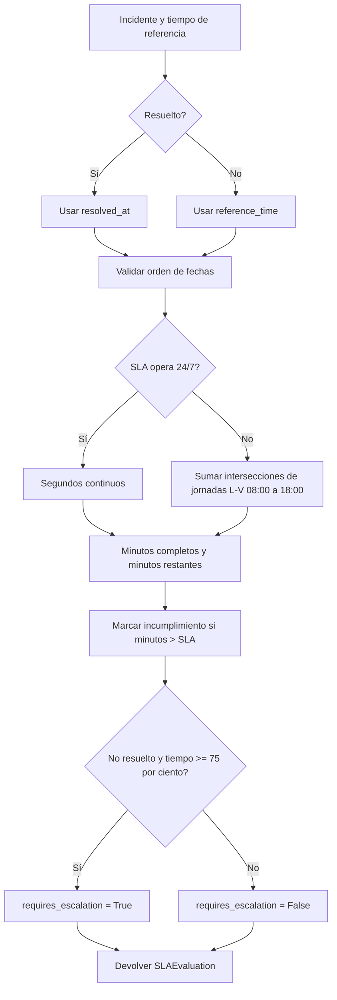

# ADR-002: Cálculo de SLA en horario hábil y escalamiento preventivo

- **Estado**: Implementado y verificado (pendiente de aprobación del equipo)
- **Fecha**: 2026-11-17
- **Autor(es)**: Asistente GPT-6; revisión humana pendiente
- **Componentes Afectados**: `src/sla_calculator.py`, `tests/test_sla_calculator.py`

---

## 1. Contexto y Problema

La implementación inicial descontaba minutos calendario a toda severidad. Sin embargo, `SLA_POLICY_TABLE` establece que P0 (60 minutos) y P1 (240) operan 24/7, mientras P2 (480) y P3 (1440) solo consumen minutos de lunes a viernes, 08:00–18:00. También omitía el escalamiento después de vencer (`not is_breached`), a pesar de que los incidentes abiertos incumplidos deben seguir escalados. Son casos críticos las aperturas en sábado, viernes después de las 18:00, cruces de varios días y resolución posterior al vencimiento.

## 2. Opciones Consideradas

1. **Opción A — Diferencia continua para todos**: código sencillo y O(1), pero erróneo para P2/P3; descartada.
2. **Opción B — Sumar intersecciones por jornada [08:00, 18:00)**: determinista, sin librerías adicionales, O(D) en días y O(1) espacio; elegida.
3. **Opción C — Calendario externo con festivos, zonas y reglas corporativas**: flexible para producción multi-región, pero agrega complejidad, dependencias y riesgos no pedidos; se pospone.

## 3. Decisión Arquitectónica

Para P0/P1 se obtiene la duración continua. Para P2/P3 se recorren los días inclusivos entre creación y evaluación, sumando únicamente la intersección de cada día laborable con la jornada local. Se acumulan segundos, se obtienen minutos completos una sola vez, y se calculan los minutos restantes. Se considera incumplido cuando los minutos completos exceden el máximo (regla `>` heredada); se marca `requires_escalation` desde el 75% exacto del tiempo permitido, incluso si el SLA ya está incumplido, mientras el estado sea distinto de `RESOLVED`. En tickets resueltos se usa `resolved_at`, se conserva el incumplimiento histórico y se desactiva el escalamiento activo.

## 4. Consecuencias e Impacto

- **Positivas**: elimina descuento de noches y fines de semana, respeta presupuestos definidos en el modelo, mantiene escalamiento activo tras incumplimiento y facilita pruebas reproducibles.
- **Negativas / Trade-offs**: iteración O(D) para rangos largos; no se descuentan festivos ni pausas, y no existe calendario por cliente. Las fechas deben estar normalizadas a la zona local de la operación; se rechazan mezclas de fechas naive y aware y cambios de offset para P2/P3. Para casos de DST/multi-zona o políticas de feriados se requiere un calendario de negocio explícito.
- **Semántica de límites**: jornada [08:00, 18:00), se acumulan segundos y solo se redondea al final; `is_breached` sigue la comparación estricta `>` del módulo original. `remaining_minutes` puede ser negativo tras el vencimiento.
- **Verificación**: `python -m unittest discover -s tests -v` y `python -m src.sla_calculator`. Las pruebas cubren viernes a lunes, apertura fuera de horario, sábado, varios fines de semana, 24/7, umbral exacto, vencimiento, resuelto y fronteras de jornada.

## 5. Trazabilidad y alcance

La decisión es específica del Reto 2 del taller. No se cambian reglas de `incident_repository.py`. Un equipo humano debe revisar la semántica de vencimiento exacto, festivos y zona de operación antes de producción.
