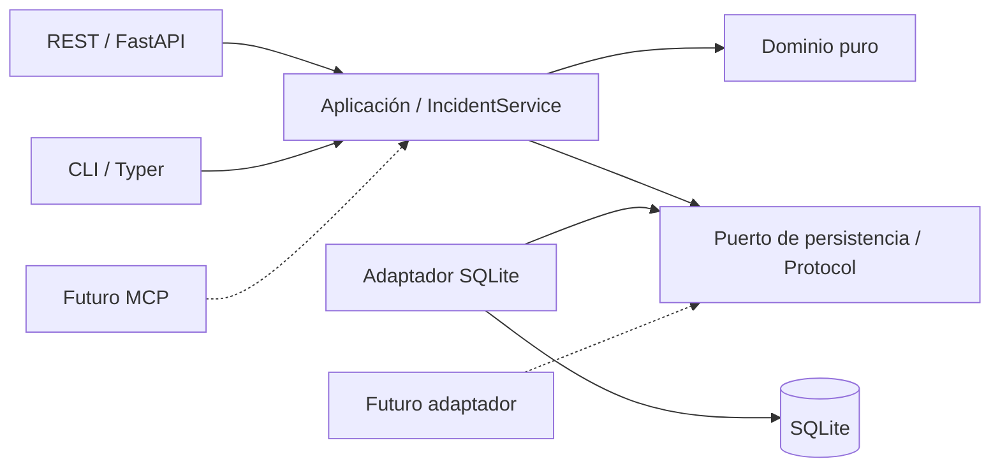

# ADR-003: Adopción de Arquitectura Hexagonal — Puertos y Adaptadores

- **Estado**: Aceptado
- **Fecha**: 2026-11-24
- **Autor(es)**: Equipo IncidentOps (decisión aprobada por el usuario; redacción asistida)

---

## 1. Contexto y Problema

IncidentOps debe exponer el mismo triaje y resumen de incidentes en REST y terminal, con futura incorporación de MCP y persistencia intercambiable. Los módulos deterministas existentes no deben depender de frameworks ni duplicar reglas al ampliar las interfaces.

---

## 2. Opciones Consideradas

1. **Opción A — Arquitectura en capas tradicional acoplada a FastAPI y SQLite**:
   - *Ventajas*: arranque rápido, menos abstracciones y composición sencilla.
   - *Desventajas*: casos de uso ligados al transporte o almacenamiento; mayor costo de reutilización en CLI y pruebas aisladas.
2. **Opción B — Arquitectura Hexagonal (puertos y adaptadores)**:
   - *Ventajas*: dominio independiente, casos de uso compartidos, persistencia sustituible y pruebas aisladas.
   - *Desventajas*: más fronteras y composición explícita de dependencias.

---

## 3. Decisión Arquitectónica

Adoptar la opción B. El dominio puro reside en `src/domain/`. La aplicación en `src/application/` ofrece IncidentService y puertos secundarios con typing.Protocol. Los adaptadores primarios REST y CLI en `src/adapters/inbound/` invocan los mismos casos de uso. Los adaptadores secundarios en `src/adapters/outbound/` implementan los puertos; el núcleo desconoce sus tecnologías. MCP y otro motor son extensiones futuras, no entregables actuales.

Las flechas representan dependencias de código, excepto SQLite hacia su almacenamiento físico.

---

## 4. Consecuencias y Trade-offs

- **Positivas**: paridad REST/CLI, dominio determinista, posibilidad de reemplazar adaptadores y pruebas independientes.
- **Negativas / Trade-offs**: mayor disciplina de imports y composición, interfaces y pruebas de contrato adicionales.
