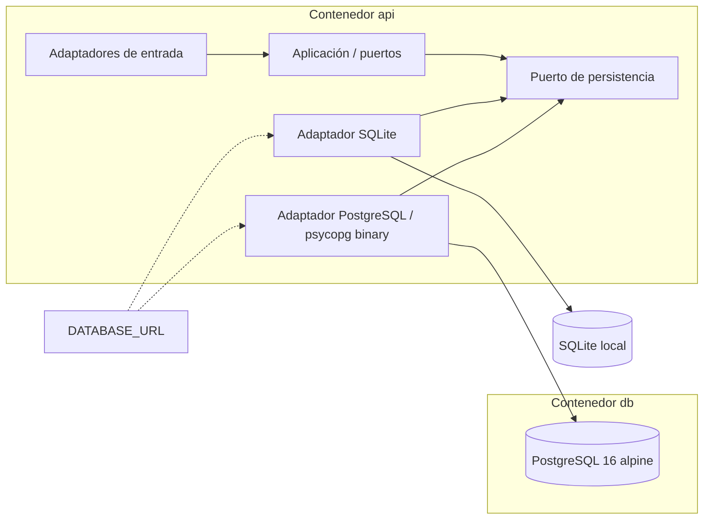

# ADR-004: Persistencia dual SQLite/PostgreSQL y runtime en contenedores

- **Estado**: Aceptado
- **Fecha**: 2026-11-24
- **Autor(es)**: Equipo IncidentOps (decisión aprobada en el taller; redacción asistida)
- **Reemplaza a**: ADR-001 (parcialmente: solo la restricción de sqlite3 exclusivo sin dependencias externas)
- **Reemplazado por**: —

---

## 1. Contexto y Problema

El roadmap exige una ejecución reproducible en contenedores con base de datos relacional dedicada y un chequeo real de conectividad. ADR-001 fijó SQLite3 sin dependencias externas para el resumen local, pero esa restricción no cubre un despliegue con base de datos de red. La decisión estructural es una sola: adoptar una topología portable con persistencia dual gobernada por configuración, sin ORM, que mantenga el mismo contrato en desarrollo, pruebas y despliegue. No se redefinen reglas de triaje, políticas de SLA ni criterios de aceptación.

---

## 2. Opciones Consideradas

1. **Opción A — SQLite único y ejecución en proceso local**:
   - *Ventajas*: cero servicios externos, arranque inmediato y pruebas deterministas; continuidad con ADR-001.
   - *Desventajas*: concurrencia de escritura y persistencia compartida limitadas; no cubre la topología con base de datos dedicada del roadmap.
2. **Opción B — PostgreSQL único con ORM en contenedores api/db**:
   - *Ventajas*: un solo motor en todos los entornos; mapeo y migraciones provistos por el ORM.
   - *Desventajas*: desarrollo y pruebas pasan a depender de infraestructura; la dependencia del ORM desplaza responsabilidades hacia el mapeo y tensiona el dominio determinista.
3. **Opción C — Persistencia dual sin ORM y topología api/db con PostgreSQL dedicado**:
   - *Ventajas*: SQLite permanece como motor local y de pruebas; PostgreSQL atiende el despliegue compartido; un mismo puerto y casos de uso sirven a ambos; el driver `psycopg[binary]` mantiene delgada la capa de salida.
   - *Desventajas*: dos dialectos SQL que mantener y verificar; el formato común de timestamps exige disciplina; Docker Compose añade superficie operativa.

---

## 3. Decisión Arquitectónica

Adoptar la opción C. La composición selecciona el adaptador según `DATABASE_URL`: esquemas `sqlite` para SQLite y esquemas `postgres` para PostgreSQL, sin ORM. La aplicación se ejecuta como contenedor `api` y la base como contenedor `db` sobre `postgres:16-alpine`, orquestados por Docker Compose. Los timestamps se almacenan como `TEXT` en ISO 8601 en ambos motores para preservar la paridad temporal y evitar conversiones dependientes del driver. SQLite3 sigue siendo el motor de desarrollo local y pruebas. Cualquier cambio de motor o de driver requiere un nuevo ADR.

Las flechas continuas representan dependencias de código o de almacenamiento; las punteadas indican selección por configuración.

---

## 4. Consecuencias y Trade-offs

- **Positivas**: ejecución reproducible en contenedores; paridad REST/CLI en ambos motores; desarrollo y pruebas sin servicios externos; paridad temporal por `TEXT` ISO 8601; núcleo libre de ORM.
- **Negativas / Trade-offs**: mantenimiento de dos adaptadores SQL y verificación de su paridad; `TEXT` ISO 8601 limita el uso de funciones temporales nativas del motor y exige normalización; Compose incorpora configuración y superficie de operación.
- **Reemplazo parcial de ADR-001**: su decisión se conserva íntegramente para SQLite local y pruebas; solo deja de ser excluyente la restricción de sqlite3 sin dependencias externas en el despliegue con PostgreSQL.
